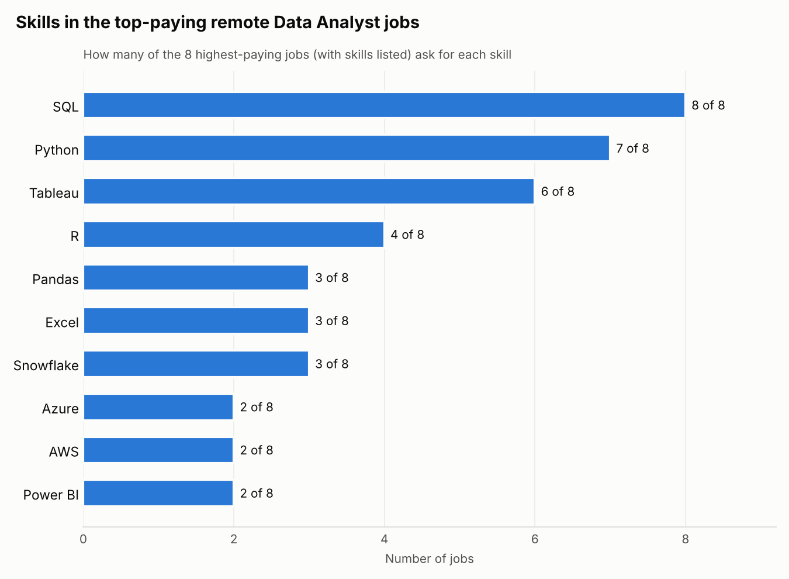
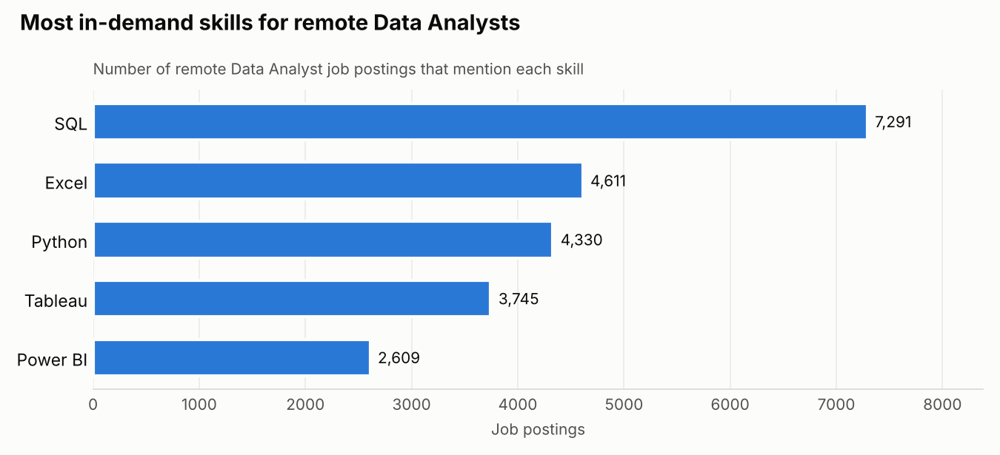
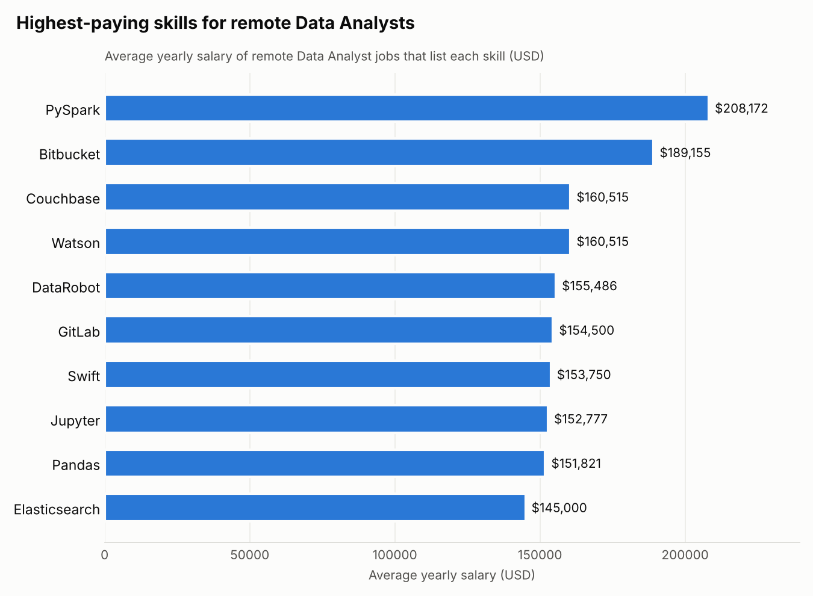

# Introduction

What does it take to land a high-paying remote **Data Analyst** job?

This project uses **SQL** to answer that question with real job-posting data. I looked at which remote Data Analyst jobs pay the most, which skills those jobs ask for, which skills employers want most often, and which skills come with the biggest salaries. Finally, I combined demand and pay to find the **optimal skills**: the ones that are both in high demand and well paid.

All SQL queries are in the [project_sql](/project_sql/) folder.

| Item | Detail |
|---|---|
| **Role studied** | Data Analyst |
| **Focus** | Remote jobs (`job_location = 'Anywhere'` or `job_work_from_home = True`) |
| **Data size** | 787,686 job postings, 140,033 companies, 259 skills |
| **Tools** | PostgreSQL, VS Code, Git and GitHub |
| **Number of queries** | 5 |

# Background

I am learning data analysis, and I wanted my first SQL project to answer a question that matters to anyone entering the field: **if I want a well-paid remote Data Analyst job, which skills should I learn first?**

Job boards are full of postings, but reading them one by one does not show the bigger picture. A database does. The data comes from [Luke Barousse's SQL course](https://lukebarousse.com/sql) and covers data job postings from 2023. It has four tables:

| Table | What it holds |
|---|---|
| `job_postings_fact` | One row per job posting: title, location, salary, posting date and more |
| `company_dim` | Company names, linked to each job by `company_id` |
| `skills_dim` | Skill names such as SQL, Python and Tableau |
| `skills_job_dim` | A link table that says which skills each job asks for |

### The five questions I answered

1. What are the top-paying remote Data Analyst jobs?
2. What skills do those top-paying jobs require?
3. What skills are most in demand for remote Data Analysts?
4. Which skills are linked to the highest salaries?
5. What are the optimal skills to learn: high demand **and** high pay?

# Tools I used

| Tool | How I used it |
|---|---|
| **SQL** | The main tool. Every question in this project is answered with a SQL query. |
| **PostgreSQL** | The database that stores the job data and runs my queries. |
| **pgAdmin** | Used to load the CSV files into the database with the `\copy` command. |
| **Visual Studio Code** | Where I wrote and ran my queries, using the SQLTools extension. |
| **Git and GitHub** | To track changes to my code and share the project publicly. |

# The analysis

Each query below answers one question. For each one I explain what the query does in plain words, show the code, and share what I found.

## 1. Top-paying remote Data Analyst jobs

**What the query does:** it filters the job postings down to Data Analyst roles that are fully remote and list a yearly salary, joins the company table to show the company name, then sorts by salary from highest to lowest and keeps the top 10.

```sql
SELECT
    job_id,
    job_title,
    job_location,
    job_schedule_type,
    salary_year_avg,
    job_posted_date,
    name AS company_name
FROM
    job_postings_fact
LEFT JOIN company_dim
    ON job_postings_fact.company_id = company_dim.company_id
WHERE
    job_title_short = 'Data Analyst' AND
    job_location = 'Anywhere' AND
    salary_year_avg IS NOT NULL
ORDER BY
    salary_year_avg DESC
LIMIT
    10;
```

**Results:**

| Rank | Job title | Company | Average yearly salary |
|---|---|---|---|
| 1 | FILL IN FROM QUERY 1 RESULTS | FILL IN | FILL IN |
| 2 | FILL IN FROM QUERY 1 RESULTS | FILL IN | FILL IN |
| 3 | Associate Director, Data Insights | AT&T | $255,830 |
| 4 | Data Analyst, Marketing | Pinterest | $232,423 |
| 5 | Data Analyst (Hybrid/Remote) | UCLA Health | $217,000 |
| 6 | Principal Data Analyst (Remote) | SmartAsset | $205,000 |
| 7 | Director, Data Analyst (Hybrid) | Inclusively | $189,309 |
| 8 | Principal Data Analyst, AV Performance Analysis | Motional | $189,000 |
| 9 | Principal Data Analyst | SmartAsset | $186,000 |
| 10 | ERM Data Analyst | Get It Recruit, Information Technology | $184,000 |

**What I found:**

- **Remote Data Analyst roles can pay very well.** Every job in the top 10 pays $184,000 a year or more.
- **Senior titles dominate the top.** Words like Director, Principal and Associate Director appear in most of the top jobs. Experience and leadership are part of what these salaries pay for.
- **The employers are varied.** Telecoms (AT&T), social media (Pinterest), healthcare (UCLA Health), finance (SmartAsset) and self-driving cars (Motional) all appear. Data skills are valued across many industries.

## 2. Skills required by the top-paying jobs

**What the query does:** it reuses query 1 as a **CTE** (a temporary, named result) and joins it to the two skills tables. That shows every skill listed by each of the top-paying jobs.

```sql
WITH top_paying_jobs AS (
    SELECT
        job_id,
        job_title,
        salary_year_avg,
        name AS company_name
    FROM
        job_postings_fact
    LEFT JOIN company_dim
        ON job_postings_fact.company_id = company_dim.company_id
    WHERE
        job_title_short = 'Data Analyst' AND
        job_location = 'Anywhere' AND
        salary_year_avg IS NOT NULL
    ORDER BY
        salary_year_avg DESC
    LIMIT
        10
)

SELECT
    top_paying_jobs.*,
    skills
FROM
    top_paying_jobs
INNER JOIN skills_job_dim
    ON top_paying_jobs.job_id = skills_job_dim.job_id
INNER JOIN skills_dim
    ON skills_job_dim.skill_id = skills_dim.skill_id
ORDER BY
    salary_year_avg DESC;
```

**Results:** the query returned 66 rows (one row per skill per job), covering **8 jobs**. The other 2 of the top 10 jobs have no skills listed, so the `INNER JOIN` leaves them out.



| Skill | Jobs that ask for it (out of 8) | Share |
|---|---|---|
| SQL | 8 | 100% |
| Python | 7 | 88% |
| Tableau | 6 | 75% |
| R | 4 | 50% |
| Pandas | 3 | 38% |
| Excel | 3 | 38% |
| Snowflake | 3 | 38% |
| Azure, AWS, Power BI, Oracle | 2 each | 25% |

**What I found:**

- **SQL is a must.** Every single top-paying job asks for it.
- **Python is close behind.** 7 out of 8 jobs want it, which makes it the most valuable skill after SQL.
- **Tableau is the leading visualisation tool.** It appears in 6 jobs, three times as often as Power BI.
- **Cloud tools appear in senior roles.** Snowflake, Azure and AWS show up in the director-level and principal-level jobs.
- **Data quality note:** two SmartAsset postings are almost identical and list the same 9 skills, so a few of the smaller skills (Go, NumPy, GitLab) are counted twice.

## 3. Most in-demand skills for remote Data Analysts

**What the query does:** this time I looked at **all** remote Data Analyst postings, not just the best-paid ones. The query joins jobs to skills, groups the rows by skill, counts how many postings mention each one, and keeps the top 5.

```sql
SELECT
    skills,
    COUNT(skills_job_dim.job_id) AS demand_count
FROM
    job_postings_fact
INNER JOIN skills_job_dim
    ON job_postings_fact.job_id = skills_job_dim.job_id
INNER JOIN skills_dim
    ON skills_job_dim.skill_id = skills_dim.skill_id
WHERE
    job_title_short = 'Data Analyst' AND
    job_work_from_home = True
GROUP BY
    skills
ORDER BY
    demand_count DESC
LIMIT
    5;
```

**Results:**



| Rank | Skill | Job postings |
|---|---|---|
| 1 | SQL | 7,291 |
| 2 | Excel | 4,611 |
| 3 | Python | 4,330 |
| 4 | Tableau | 3,745 |
| 5 | Power BI | 2,609 |

**What I found:**

- **SQL leads by a wide margin.** It appears in almost 60% more postings than Excel, the next skill.
- **Excel still matters.** Even with modern tools around, spreadsheets are the second most requested skill. Many teams still run on them.
- **The core toolkit is clear:** a database language (SQL), a spreadsheet (Excel), a programming language (Python) and a visualisation tool (Tableau or Power BI).

## 4. Skills linked to the highest salaries

**What the query does:** for every skill, it works out the average salary of remote Data Analyst jobs that list that skill, rounds it to whole dollars, and sorts from highest to lowest.

```sql
SELECT
    skills,
    ROUND(AVG(salary_year_avg), 0) AS avg_salary
FROM
    job_postings_fact
INNER JOIN skills_job_dim
    ON job_postings_fact.job_id = skills_job_dim.job_id
INNER JOIN skills_dim
    ON skills_job_dim.skill_id = skills_dim.skill_id
WHERE
    job_title_short = 'Data Analyst'
    AND salary_year_avg IS NOT NULL
    AND job_work_from_home = True
GROUP BY
    skills
ORDER BY
    avg_salary DESC
LIMIT
    25;
```

**Results (top 10 of 25):**



| Rank | Skill | Average yearly salary | What it is |
|---|---|---|---|
| 1 | PySpark | $208,172 | Processing very large datasets with Python |
| 2 | Bitbucket | $189,155 | Storing and sharing code |
| 3 | Couchbase | $160,515 | A NoSQL database |
| 4 | Watson | $160,515 | IBM's AI and machine learning platform |
| 5 | DataRobot | $155,486 | Automated machine learning |
| 6 | GitLab | $154,500 | Storing and sharing code |
| 7 | Swift | $153,750 | A programming language |
| 8 | Jupyter | $152,777 | Notebooks for writing and running code |
| 9 | Pandas | $151,821 | A Python library for working with data tables |
| 10 | Elasticsearch | $145,000 | Searching and analysing large amounts of text |

**What I found:**

- **Big data and AI skills pay the most.** PySpark, Watson, DataRobot and Databricks point to analysts who work with very large datasets or machine learning.
- **Engineering skills raise pay.** Code-sharing tools such as Bitbucket and GitLab suggest that analysts who work like software developers are paid more.
- **Python libraries pay off.** Pandas, Jupyter and NumPy all sit near the top, which shows the value of Python beyond the basics.
- **A warning:** many of these skills appear in only a handful of jobs. A high average from a few postings does not mean there are many jobs available. That is why query 5 combines pay with demand.

## 5. Optimal skills: high demand and high pay

**What the query does:** it combines queries 3 and 4. For each skill it counts the remote Data Analyst jobs that ask for it **and** works out their average salary, in a single query. `HAVING` removes skills that appear in 10 jobs or fewer, so rare skills cannot top the list by luck.

```sql
SELECT
    skills_dim.skill_id,
    skills_dim.skills,
    COUNT(skills_job_dim.job_id) AS demand_count,
    ROUND(AVG(job_postings_fact.salary_year_avg), 0) AS avg_salary
FROM
    job_postings_fact
INNER JOIN skills_job_dim
    ON job_postings_fact.job_id = skills_job_dim.job_id
INNER JOIN skills_dim
    ON skills_job_dim.skill_id = skills_dim.skill_id
WHERE
    job_title_short = 'Data Analyst'
    AND salary_year_avg IS NOT NULL
    AND job_work_from_home = True
GROUP BY
    skills_dim.skill_id
HAVING
    COUNT(skills_job_dim.job_id) > 10
ORDER BY
    avg_salary DESC,
    demand_count DESC
LIMIT
    25;
```

**Results (top 10 of 25):**

| Rank | Skill | Jobs that list it | Average yearly salary |
|---|---|---|---|
| 1 | FILL IN FROM QUERY 5 RESULTS | | |
| 2 | | | |
| 3 | | | |
| 4 | | | |
| 5 | | | |
| 6 | | | |
| 7 | | | |
| 8 | | | |
| 9 | | | |
| 10 | | | |

**What I found:**

- FILL IN AFTER RUNNING QUERY 5

# What I learned

This project took me from basic queries to real analysis. The main skills I built:

- **Filtering and sorting:** using `WHERE`, `ORDER BY` and `LIMIT` to narrow 787,686 postings down to the exact rows I need.
- **Joining tables:** using `LEFT JOIN` and `INNER JOIN` to connect jobs, companies and skills through shared ID columns, and understanding why an `INNER JOIN` can drop rows that have no match.
- **Summarising data:** using `COUNT()`, `AVG()` and `ROUND()` with `GROUP BY` to turn thousands of rows into one clear answer per skill.
- **Filtering groups:** using `HAVING` to filter results after they are counted, which `WHERE` cannot do.
- **CTEs:** using `WITH ... AS (...)` to save a query as a temporary table and build on it step by step.
- **Setting up a database:** creating a PostgreSQL database, creating tables and loading large CSV files with `\copy`.
- **Checking my results:** questioning numbers that look wrong. For example, I found that many jobs labelled "Sudan" in the `job_country` column were actually located in the United States.
- **Version control:** using Git and GitHub to save my work and publish this project.

# Conclusions

## Insights

1. **SQL is the most important skill for Data Analysts.** It is the most requested skill in remote Data Analyst postings (7,291 jobs) and appears in every one of the top-paying jobs.
2. **Python is the best second skill.** It is the third most in-demand skill and appears in 7 of the 8 top-paying jobs that list skills.
3. **A visualisation tool is essential.** Tableau and Power BI are both in the top 5 for demand, and Tableau appears in 6 of the 8 top-paying jobs.
4. **Excel is still widely used.** It is the second most in-demand skill, even though it appears less often in the highest-paying roles.
5. **Specialist skills pay more but have fewer openings.** Big data, AI and engineering tools such as PySpark, Watson and Bitbucket bring the highest average salaries, but they appear in far fewer postings.
6. **The best strategy is to build in layers.** First learn the core skills that get you hired (SQL, Excel, Python, Tableau or Power BI), then add specialist and cloud skills (Snowflake, Azure, AWS, PySpark) to move into higher-paying roles.

## Closing thoughts

This project improved my SQL and gave me a clear, data-driven learning plan. Instead of guessing which skills to learn, I can now point to evidence: SQL, Python and a visualisation tool form the foundation, and cloud and big data skills open the door to the highest salaries.

It also taught me that good analysis is more than writing queries that run. It means asking clear questions, checking whether the results make sense, and explaining the findings in plain words that anyone can understand.

**Next steps:** I plan to repeat this analysis for other roles, compare remote jobs with on-site jobs, and look at how demand for each skill changes month by month.

*Data source: [Luke Barousse's SQL for Data Analytics course](https://lukebarousse.com/sql). The postings are from 2023.*
